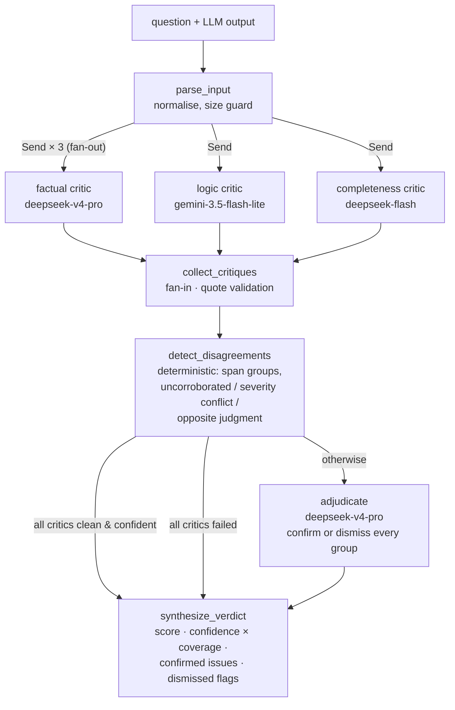

# LLM Output Arbitration

**Does multi-model critique catch more problems than one strong model reviewing alone?**
I built a system to find out: three specialised critic agents on **different providers**
independently review an LLM output, a deterministic detector finds where they disagree, and an
adjudicator resolves the disagreements into one confidence-scored verdict. Then I tested it
against a single-reviewer baseline on 40 outputs with hand-planted errors.

## The result

> **On 40 hand-written test cases (35 planted errors), the multi-critic system caught 94%
> (33/35) of planted errors vs 97% (34/35) for a single reviewer, with 23 false flags vs 6
> (precision 59% vs 86%), at 5× the cost and ~6× the latency. It did not beat the baseline.**

That is the pre-registered result (matching rules fixed before the run). One round of tuning
afterwards (v2) fixed the false flags but not the detection gap:

| | Planted errors caught | False flags | Precision | Correct pass/fail | Cost / case | LLM time / case |
|---|---|---|---|---|---|---|
| **v1 – multi-critic system** | 94% (33/35) | 23 | 59% | 95% (38/40) | $0.0060 | 31.2 s |
| **v1 – single reviewer** | **97% (34/35)** | **6** | **86%** | **98% (39/40)** | **$0.0012** | **4.8 s** |
| v2 – multi-critic system ⚠️ | 94% (33/35) | **2** | **94%** | 95% (38/40) | $0.0057 | 11.4 s |
| v2 – single reviewer ⚠️ | **97% (34/35)** | 5 | 88% | **98% (39/40)** | **$0.0017** | **5.0 s** |

⚠️ *v2 changed the prompts after seeing v1 results on the same 40 cases, so its numbers are
optimistic. 95% intervals on recall are roughly 81–98% (system) and 85–99% (baseline). The
recall difference rests on a single discordant error (paired exact McNemar p = 1.0), so it is
noise; the cost and latency differences are not.*

**What the experiment shows**

1. **No detection gain from model diversity.** Across both runs the system caught zero planted
   errors that the single reviewer missed. The baseline already caught 97%, which left almost no
   headroom; only two cases were genuinely hard.
2. **Specialists only add up to one generalist.** Alone, the factual critic caught 60%, the logic
   critic 49% and the completeness critic 29%. Their union reached 94%, the same as a single
   well-prompted call.
3. **A narrow lane creates noise.** Told to look only for omissions, the completeness critic
   re-described other errors as "missing" content and nitpicked: 38 issues, 10 real (v1). Scoping
   it to what the question actually asks cut its false flags from 28 to 11.
4. **The adjudicator is precise but conservative.** All 21 of its dismissals across both runs
   removed a false flag, and it never threw away a real catch. In v1, though, it let 23 false
   flags through.
5. **Critics share blind spots. This was measured, not assumed.** On *Everest boiling point*,
   all three critics (two providers) confidently accepted a wrong "50 °C", so the unanimous-pass
   short-circuit skipped adjudication. The single reviewer, on the **same** model as the factual
   critic, caught it. Prompt and sampling variance on one model was larger than the
   between-provider effect.
6. **Both missed the arithmetic case** ($431,676 − $200,000 ≠ $131,676). Neither recomputed the
   subtraction. That points to tools (a calculator), not more reviewers.

Full reports: [`reports/eval_report.md`](reports/eval_report.md) (v1, pre-registered) ·
[`reports/eval_report_v2.md`](reports/eval_report_v2.md) (v2) · spend for the two reported runs:
$0.59 at list prices.

## How it works



1. **Three critics run in parallel** (a LangGraph `Send` fan-out), each owning one dimension:
   factual accuracy, logical consistency, completeness. Each returns structured issues: an exact
   quote, the problem, a severity, and its own confidence.
2. **Every quote is checked against the text.** If a quote isn't there, the issue is marked
   invalid instead of trusted.
3. **A deterministic detector** groups issues that point at the same text and labels the
   disagreements: raised by one critic only, severities two or more levels apart, or flagged by
   one critic but explicitly verified correct by another.
4. **The adjudicator** reasons through every group with a procedure per dimension:
   - factual: check against the text and its own knowledge;
   - logic: trace the reasoning step by step;
   - completeness: re-read what the question asked.

   It confirms or dismisses each group and gives the reason either way.
5. **Verdict:** a 1–10 score, a confidence scaled by how many dimensions were actually
   reviewed, the confirmed issues with their evidence, and the dismissed flags with reasons.
   The output fails if any confirmed issue is medium severity or worse.

If a critic fails after retries, the others continue and the verdict is marked `degraded`, with
that dimension flagged low-confidence. If the adjudicator fails, the verdict falls back to the
union of critic issues at half confidence.

## Verdict Explorer

> 📸 *Screenshot placeholder:* `docs/screenshots/verdict-view.png`. Evaluated text with red
> (confirmed), amber (low-confidence) and grey (dismissed) highlights; clicking one opens its
> evidence chain: critic flag → disagreement → adjudicator ruling → final status.

> 📸 *Screenshot placeholder:* `docs/screenshots/critic-comparison.png`. Critics side by side
> (score, confidence, issues, verified claims), plus the agreements and disagreements tables.

> 📸 *Screenshot placeholder:* `docs/screenshots/eval-results.png`. The analytics page:
> system vs single reviewer, ablations, critic analytics, v1/v2 switch.

## Architecture decisions

- **A different provider per critic.** The core hypothesis was that models trained differently
  fail differently. DeepSeek and Gemini are reached through the official `openai` SDK at
  OpenAI-compatible endpoints, so a provider is a config entry, not code. *(Measured outcome: the
  diversity produced no extra catches on this test set. See result 5.)*
- **Quotes are validated against the text, and fakes are counted rather than retried away.**
  Matching is exact first, then forgiving only of cosmetic differences (quote marks, dashes,
  spacing, case), with no fuzzy matching, because a paraphrased "quote" is invented evidence. A
  critic can't certify its own quote either: `valid` is set by our code, not by the model.
  *(Measured: 0% invented quotes in both runs, so the safety net never fired.)*
- **Unanimous confident passes skip the adjudicator.** If every critic ran, none raised a valid
  issue, and each is at least 80% confident, the expensive adjudicator call is skipped. It
  short-circuited 20 cases across both runs, 19 correctly. The one wrong skip is the Everest
  shared blind spot.
- **The adjudicator lists what it dismissed, with reasons.** Every flag ends up either confirmed
  or dismissed, so nothing silently disappears and the UI can show the full evidence chain. The
  adjudicator can't add new issues: it uses the same model as the baseline, so letting it add
  findings would make the system "baseline plus extras" and the comparison meaningless.
- **A strong baseline, and ablations at no extra cost.** The baseline uses the system's strongest
  model with the *same* quote rules, severity definitions and per-dimension checklists (shared
  prompt blocks), the same quote validation and the same pass/fail rule. The ablations (each
  critic alone, union without adjudicator) are computed from the stored outputs of the same run,
  so they see identical critic findings and cost nothing.
- **Disagreement detection is plain Python, not an LLM.** Union-find over overlapping text spans
  makes it free, deterministic and unit-tested. Completeness issues never group by text span,
  because their quote only marks where something is missing.
- **One retry layer.** The SDK's built-in retries are off, so transient errors (per-minute 429s,
  503s, timeouts, empty replies) are retried in exactly one place, with backoff that honours the
  server's suggested wait. Errors where retrying can't help (bad key, daily quota, unknown model)
  fail immediately with a message saying what to change.
- **LLM text is treated as hostile.** The text under review is wrapped as *data* in the prompts
  (prompt-injection defence), and the UI escapes all model-generated text before rendering it,
  with a test that fires an actual `</script>` injection payload.

## Evaluation method

- **Test set** ([`data/testset.yaml`](data/testset.yaml)): 40 hand-written cases covering 8
  domains. 10 are clean and 30 are flawed, with 35 planted errors (15 factual, 10 logic, 10
  completeness), including subtle errors hidden in otherwise excellent answers. The answer keys
  are human-written. [`scripts/case_builder.py`](scripts/case_builder.py) only drafts *clean*
  answers (a test asserts its prompt never mentions errors), and a case only counts once a human
  marks it `ready`.
- **Matching:**
  - *Factual and logic errors* match by quoted-span overlap (≥ 50% of the shorter span).
  - *Omissions have no text to point at*, so a completeness complaint matches a planted omission
    only if a blind LLM judge (deepseek-flash) confirms they describe the same missing item. The
    judge never sees which system raised a complaint, and its decisions are cached so every
    variant gets the same rulings.
  - Every judge match is listed in the report for spot-checking.
- **Statistics:** every rate carries a 95% Wilson interval. System vs baseline is compared
  paired, per planted error, with an exact McNemar test. Latency is critical-path model time
  (slowest critic plus adjudicator), timed inside the concurrency slot so the eval's own
  parallelism doesn't distort it.
- **Sensitivity check:** the strict rule counts a completeness critic re-describing a planted
  factual error as a false flag. The report shows the numbers both ways (v1: 23 vs 12 system
  false flags); the conclusion doesn't change.

## Quick start (Docker)

```bash
cp .env.example .env            # add DEEPSEEK_API_KEY and GEMINI_API_KEY (optional for the demo)
docker compose up --build
# UI   → http://localhost:8501   (seeded with 7 demo arbitrations, no keys needed to browse)
# API  → http://localhost:8000/docs
```

Port taken? `API_PORT=8020 UI_PORT=8520 docker compose up`. Both services share one SQLite
file on a named volume. The API is the only writer and seeds the demo data on first start; the
UI reads the file and submits new arbitrations through the API.

## API

```bash
curl -s localhost:8000/v1/arbitrate -H 'content-type: application/json' -d '{
  "question": "Who wrote Pride and Prejudice, and when was it published?",
  "output":   "Pride and Prejudice was written by Charlotte Brontë and published in 1813."
}'
```

| Endpoint | |
|---|---|
| `POST /v1/arbitrate` | One output (+ optional question) → full verdict with evidence chain; stored |
| `POST /v1/arbitrate/batch` | Up to 20 outputs concurrently; per-item errors never fail the batch |
| `GET /v1/arbitrations/{id}` | The stored audit record, exactly as produced |
| `GET /v1/arbitrations?batch_id=…` | Summaries, newest first, paginated |

## Local development

Requires Python 3.12. LangGraph's `langsmith` dependency emits deprecation warnings on 3.14,
and the Docker image is pinned to 3.12.

```bash
python3.12 -m venv .venv && source .venv/bin/activate
pip install -r requirements-dev.lock && pip install -e ".[dev]"
pytest                                   # 189 tests; every LLM call is mocked
uvicorn arbiter.api.main:app --reload    # API
streamlit run src/arbiter/ui/app.py      # UI (set ARBITER_API_URL if the API isn't on :8000)

python scripts/arbitrate.py --baseline   # live: system vs single reviewer on a sample
python scripts/evaluate.py --limit 5     # live eval on 5 cases (~$0.04)
python scripts/evaluate.py --from-run reports/runs/<run>   # re-score saved results for free
python scripts/case_builder.py check     # test-set coverage vs the checklist
```

## Adding providers and critics

Everything is in [`config.yaml`](config.yaml). Any OpenAI-compatible endpoint works:

```yaml
providers:
  together:                          # new provider
    base_url: https://api.together.xyz/v1
    api_key_env: TOGETHER_API_KEY
    structured_mode: json            # or json_schema if it supports schema-enforced output
models:
  llama-big:
    provider: together
    model_id: <model id from the provider's docs>
    pricing: {input: 0.9, cached_input: 0.9, output: 0.9}   # USD per 1M tokens
roles:
  critics:
    logic: llama-big                 # swap a core critic
  extra_critics:                     # or add one on an existing dimension
    factual_local: {dimension: factual, model: ollama-local}
```

Extra critics join the fan-out automatically and take part in disagreement detection; a second
critic on the same dimension is what makes "opposite judgment" disagreements likely. Adding a
whole new *dimension* is a code change: the `Dimension` enum and its prompt in
`critics/prompts.py`.

## Limitations

- **No live fact-checking.** Critics, the adjudicator and the baseline judge facts from their own
  knowledge and from internal consistency only.
- **Critics share training-data blind spots,** demonstrated on Everest above. Provider diversity
  reduces correlated errors less than hoped.
- **Free-tier rate limits.** Gemini's free tier allowed only 20 requests a day for
  `gemini-3.6-flash`. The first eval run hit that limit and was discarded, and the logic critic
  moved to `gemini-3.5-flash-lite`, a weaker model. Free-tier latency also swings widely, from
  2 s to more than 90 s per call.
- **Small, single-author test set.** 35 planted errors leave wide confidence intervals, one
  person decided what counts as an error, and the baseline's 97% left little headroom to show a
  gain.
- **v2 is tuned on the test set.** It should be confirmed on held-out cases before anyone
  believes it.
- **Self-preference.** The adjudicator, the factual critic and the baseline all use
  `deepseek-v4-pro`. Model names are hidden from the adjudicator, but stylistic self-recognition
  is possible.
- **Demo-grade service.** No authentication, single-node SQLite. Prices are list prices
  (DeepSeek peak rates; Gemini paid-tier rates, although the free tier was used).

## Project structure

```
config.yaml               providers, models, role assignment, limits, thresholds
data/testset.yaml         40 hand-written cases + answer keys     data/demo/  seeded demo records
reports/                  eval_report.md (v1), eval_report_v2.md, metrics JSON
scripts/                  evaluate.py · arbitrate.py · run_critics.py · case_builder.py · seed_demo.py
src/arbiter/
  llm/                    one OpenAI-SDK client for all providers: structured JSON, retries, telemetry
  critics/                prompts (shared blocks), critic runner, quote validation
  graph/                  LangGraph state, nodes, disagreement detector, wiring
  adjudication/           LLM adjudicator, union rule (ablation/fallback), verdict synthesis
  baseline.py             single-reviewer baseline
  evaluation/             findings, matching (span + judge), metrics, runner, report
  storage/ api/ ui/       SQLite audit trail · FastAPI · Streamlit Verdict Explorer
tests/                    189 tests, all LLM calls mocked
```
